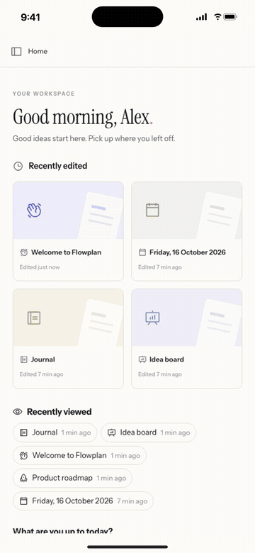

<div align="center">


# Flowplan for iPhone, iPad and Android

**Flowplan as a native app for iOS and Android, built with Expo.**

[Flowplan](https://github.com/yannicschuller/flowplan) · [Flowplan Desktop](https://github.com/yannicschuller/flowplan-desktop) · [Documentation](https://docs.flowplan.org/offline-and-apps)



</div>

The app shows a Flowplan instance in the system web view and adds what only a native app can do. All data stays on the server; Flowplan itself, and every new feature of it, arrives with the server and needs no app update. The app:

- remembers one or several instances as **profiles** (e.g. work and private), switches between them with one tap and accepts only a real Flowplan;
- signs in with passkeys and SSO through the system's sign-in sheet;
- receives **push notifications** with the number of unread notifications on the app icon;
- has **widgets** for the home screen (and the lock screen on iOS), each showing one thing with **settings of its own**: tasks to **check off right there**, today's appointments, a page or the favorites, a database counter with its last 14 days, journal and habits, the time this week with start/stop, mentions to mark read, form responses, quick capture – plus the overview, the inbox and, for administrators, the instance's state, a live number and storage;
- shows what runs as **Live Activities** (lock screen, Dynamic Island) on iOS and as ongoing notifications (Live Updates on Android 16) on Android: the timer, focus with its break, the meeting now with "Open notes", imports and exports, a voice memo being recorded, and – for administrators – an incident while it lasts;
- captures **notes, tasks, voice memos and photos** in its own screen, from widgets, **Siri and Shortcuts** (German, English, French), **Control Center and the Action button** (iOS 18), the icon's quick actions and Android **Quick Settings tiles** ("New note", "Quick capture");
- refreshes widgets, badge and timer in the background;
- has **quick actions** on the app icon: inbox, my tasks, search, new note, switch profile; on Android **app shortcuts** with the pages opened last first, "New note" and "Quick capture" (static, there before the first start), inbox, my tasks, search, voice memo and switch profile – each can be pinned to the home screen;
- can be locked with Face ID, Touch ID, a fingerprint or the device code;
- hands exports and downloads to the share sheet;
- takes text, links, photos and PDFs shared from other apps (Android, one or several files): a compact screen saves them to the inbox (the default capture database) or a chosen page or database ([`src/screens/ShareCapture.tsx`](src/screens/ShareCapture.tsx), instance action `capture.share`; older instances get text and links through their web share target);
- on iPhone and iPad, images and PDFs are saved straight from the **share sheet** into the inbox, a page or a database;
- **scans documents** with the camera into a searchable PDF (text recognised on the device) at the end of a page (iOS);
- puts the pages and open tasks into **Spotlight** (iOS);
- works on iPad and Android tablets in every orientation, in Split View, Slide Over and Stage Manager, with keyboard, trackpad and **Apple Pencil**: pen-only drawing with pressure, the eraser, hover, Scribble and Pencil double-tap and squeeze;
- paints the system bars in the page's colours, opens other sites in the system browser and shows its own page without a connection.

## How it works

The app is an [Expo](https://expo.dev) SDK 58 project (React Native 0.88, New Architecture). The Xcode and Gradle projects are not kept in the repository: `npx expo prebuild` generates them from [`app.config.ts`](app.config.ts) and the config plugins (Continuous Native Generation). Everything native is configured there – bundle IDs, permissions and their texts in German, English and French, icons, splash screen, the widget extension, signing.

| Part | Where | Native side |
| --- | --- | --- |
| Setup, offline page, app settings, app lock (with the lock on, the page is covered while the app is not in front and screenshots are blocked while locked) | [`src/screens/`](src/screens) | React Native, `expo-local-authentication`, `expo-screen-capture` |
| Window on the instance | [`src/screens/Shell.tsx`](src/screens/Shell.tsx) | `react-native-webview` (WKWebView, Android System WebView) |
| Which address is accepted | [`src/server.ts`](src/server.ts) | – (tested in [`test/`](test)) |
| Profiles: several instances, migration of the single address | [`src/profiles.ts`](src/profiles.ts), [`src/store.ts`](src/store.ts) | `expo-secure-store` (tested in [`test/profiles.test.ts`](test/profiles.test.ts)) |
| Links: app, system browser, sign-in | [`src/navigation.ts`](src/navigation.ts) | `expo-linking` |
| Passkeys and SSO | [`src/sign-in.ts`](src/sign-in.ts) | `expo-web-browser` (ASWebAuthenticationSession, Custom Tabs), `expo-crypto` |
| Bridge to the page | [`src/bridge-script.ts`](src/bridge-script.ts) | `window.FlowplanApp` in the page, see below |
| Push notifications | [`src/native/notifications.ts`](src/native/notifications.ts) | `expo-notifications` |
| Share extension, scanner, Spotlight | [`plugins/with-capture.js`](plugins/with-capture.js), [`plugins/capture/`](plugins/capture), [`modules/flowplan-capture`](modules/flowplan-capture), [`src/capture.ts`](src/capture.ts), [`src/screens/Scan.tsx`](src/screens/Scan.tsx), [`src/native/spotlight.ts`](src/native/spotlight.ts) | iOS: a share extension (SwiftUI), VisionKit and Vision, CoreSpotlight |
| Widgets and badge | [`src/native/sync.ts`](src/native/sync.ts), [`src/widgets/`](src/widgets) | iOS: `expo-widgets` with Expo UI (SwiftUI); Android: `react-native-android-widget` |
| Configurable widgets, controls, App Shortcuts | [`src/widgets/suite.ts`](src/widgets/suite.ts), [`src/native/suite.ts`](src/native/suite.ts), [`plugins/widget-suite/`](plugins/widget-suite), [`plugins/with-widget-suite.js`](plugins/with-widget-suite.js) | iOS: Swift (WidgetKit, AppIntents) in expo-widgets' extension and the app; Android: `react-native-android-widget` with a configuration screen |
| Siri and Shortcuts, Focus filters, more controls | [`plugins/intents/`](plugins/intents), [`plugins/with-intents.js`](plugins/with-intents.js), [`src/focus.ts`](src/focus.ts), [`src/native/intents.ts`](src/native/intents.ts), [`modules/flowplan-intents`](modules/flowplan-intents) | iOS: AppIntents (`SetFocusFilterIntent`, `ControlWidget`) in the app and expo-widgets' extension; a local Expo module in Swift |
| Live Activities / ongoing notifications | [`src/activities.ts`](src/activities.ts), [`src/native/activities.ts`](src/native/activities.ts), [`src/widgets/ios.tsx`](src/widgets/ios.tsx), [`modules/flowplan-native`](modules/flowplan-native) | `expo-widgets` (ActivityKit); Kotlin |
| Capture: notes, tasks, voice memos, photos | [`src/screens/Capture.tsx`](src/screens/Capture.tsx) | `expo-audio`, `expo-image-picker` |
| Background refresh | [`src/native/background.ts`](src/native/background.ts) | `expo-background-task` |
| Quick actions, haptics, share sheet | [`src/native/actions.ts`](src/native/actions.ts) | `expo-quick-actions`, `expo-haptics`, `expo-sharing`, `expo-file-system` |
| Managed configuration, Apple Pencil double-tap and squeeze | [`modules/flowplan-native`](modules/flowplan-native) | a local Expo module in Swift (`UIPencilInteraction`) and Kotlin |
| Android: share target, app shortcuts, "Quick capture" tile, Material You for widgets | [`modules/flowplan-android`](modules/flowplan-android), [`src/android/`](src/android), [`plugins/with-android-extras.js`](plugins/with-android-extras.js) | a local Expo module in Kotlin (`ShortcutManager`, `TileService`, system colours) |
| iPad windows, key commands, Handoff | [`modules/flowplan-ipad`](modules/flowplan-ipad), [`src/windows.ts`](src/windows.ts), [`src/window-features.ts`](src/window-features.ts), [`src/ipad.ts`](src/ipad.ts), [`plugins/with-ipad.js`](plugins/with-ipad.js) | a local Expo module in Swift (scenes, `UIKeyCommand`, `NSUserActivity` "app.flowplan.page") |

| | |
| --- | --- |
| **First start** | Asks for the instance and suggests `https://app.flowplan.org`. Managed installations can suggest their own address: iOS Managed App Configuration or Android app restrictions, key `server`. The app accepts only a real Flowplan: `/api/health` must answer `"service": "flowplan"`, and the address must not redirect to another site. HTTPS only; plain HTTP only for `localhost` and `10.0.2.2`, the development machine as seen from the Android emulator. |
| **Profiles** | Several instances, e.g. **Work – flowplan.company.com** and **Private – notes.example**. Switch in the app settings (**Profiles**), with the quick action **Switch profile** or from the offline page; the same screen adds a profile (address and an optional name). Rename in the app settings. **Sign out and remove the profile** signs out of the active profile's instance, removes the phone from it and switches to the next profile. An address that already has a profile switches to it. |
| **Separate profiles** | Per profile, the device token and the last summary live under keys of their own in the keychain / Keystore (`flowplan.profile.<id>.…`), so nothing of one instance is ever sent to another. Push, widgets, badge and the timer belong to the active profile: switching unregisters the phone from the previous instance (`/api/mobile/unregister`) and clears widgets and badge; the web view keeps that instance's sign-in, so switching back registers again without signing in. The web view's cookie store is shared by the whole app and keeps sign-ins per address – which is why each instance can be saved as one profile only. Pending passkey/SSO sign-ins and identity-provider hosts are dropped on a switch. |
| **Update from a single address** | The address of earlier versions becomes the first profile automatically, together with its device token and summary; the old keys are removed. |
| **Links** | Pages of the active profile's instance stay in the app. Other sites, `mailto:` and `tel:` links open in the system. Embedded content (videos, maps) stays in the page. `flowplan://open?path=/#inbox` opens a path of the instance (widgets, notifications, Live Activity); `flowplan://capture?mode=note\|task\|voice\|photo[&target=<page>]` the capture screen, `flowplan://do?action=focus.start\|focus.stop\|timer.stop\|recording.stop` a step of the app and `flowplan://meeting?…` a meeting's note, `flowplan://scan[?target=<page>[&row=<record>]]` the document scanner. Every link is checked first (paths only, ids only, a fixed list of steps). |
| **Offline** | When the instance cannot be reached, the app shows its own page and reconnects by itself when the connection is back. |
| **Native feel** | Status bar and home indicator / navigation bar take the colours the page has at its top and bottom edge; on pages that scroll as a whole they keep them, and content fades out at the edges. Dark mode follows the system. **Back** – the swipe from the left edge on iOS (a chevron follows the finger) and the back button or gesture on Android – goes back the way Flowplan is built, not through the web view's history: it closes the open dialog, menu or drawer first, then a record or comment thread, goes from a settings section to its overview and from a page to the one opened before, finally to the start page; there the gesture is off and Android's back leaves the app ([`src/back.ts`](src/back.ts), Flowplan's `lib/app-back.ts`). Instances from before that get the history. No zooming into form fields and no "previous/next/done" bar above the keyboard on iOS. |
| **Languages** | German, English and French (own screens, notifications, widgets, permission prompts). |

### iPad, tablets and Apple Pencil

- **Layout:** one app for iPhone and iPad (and Android phones and tablets), all orientations, resizable windows (Split View, Slide Over, Stage Manager, Android multi-window). On iPad the web view gets the desktop-class page, which Flowplan lays out for touch (`pointer: coarse`); the app's own screens stay a comfortable width. Keyboard shortcuts (⌘K, ⌘N …) and the trackpad pointer work as in Safari. The *Overview* widget also comes in the iPad's extra-large size.
- **Several windows** (iPad): *Open in new window* in a page's menu (and links that open a new tab) give the page a window of its own – side by side in Split View, in Slide Over or in Stage Manager; the app's icon → *Show All Windows* lists them. The first window is the main window (setup, app settings, push, widgets); the others show a page of the active profile and come back with it after a restart. Profile and app lock are the same in every window; when the main window is closed, the next one takes over ([`src/windows.ts`](src/windows.ts), [`plugins/with-ipad.js`](plugins/with-ipad.js)).
- **Hardware keyboard:** the page's shortcuts (⌘K search, ⌘N new page, ⌘⌥N capture, ⌘/ overview …, including your own from *Keyboard shortcuts*) are key commands of the window: holding ⌘ lists them in the system overlay, and pressing one runs it in that window's page. Shortcuts of the editor (⌘B, ⌘Z …) go to the page directly.
- **Handoff:** every window offers its page to your Mac and other devices (same Apple Account, Handoff on): the Flowplan desktop app opens it in its window, without it the Mac's browser opens the page. A page handed over from the Mac opens in the app on the profile of its instance (others open in Safari).
- **Drawing** on whiteboards and in the image markup (Flowplan's `lib/stylus.ts`): the pen's pressure sets the line width, fast strokes keep every measured point, a hovering Pencil (iPad Pro, iPad Air M2 and newer) shows where the stroke starts. Once the Pencil has drawn, fingers move and zoom the board instead of drawing, so a resting hand leaves no marks (*Draw with the pen only* in the pen menu). The eraser end of styluses that have one erases.
- **Double-tap and squeeze** (Apple Pencil 2nd generation, Pro): the app listens with `UIPencilInteraction` and passes the gesture with the action chosen in the iPad's settings (Settings → Apple Pencil) to the page: switch to the eraser and back, the previous tool, or the pen with its colours.
- **Scribble:** handwriting with the Pencil works in every text field of the app and the page.
- **Android:** styluses report pressure, hover and the eraser end the same way; handwriting in text fields comes with Android 14.

### Signing in with passkeys and SSO

Passkeys and identity providers that need one do not work inside an app's web view, so the app uses the browser hand-off of the desktop app (server: `lib/desktop-sign-in.ts`, `/api/auth/desktop`):

1. The instance recognises the app by `FlowplanMobile/<version>` in the user agent. It then links **Mit Passkey anmelden** / **Mit SSO anmelden** to `/api/auth/desktop`.
2. The app catches that navigation, keeps a random verifier and opens `/api/auth/desktop?challenge=<SHA-256 of the verifier>` in the system's sign-in sheet.
3. You sign in as usual (passkey, password manager, SSO) and confirm. The page hands `flowplan://sign-in?server=…&challenge=…&code=…` back.
4. The app checks the instance and its own challenge, then redeems the one-time code with its verifier from the instance's page (`/api/auth/desktop-redeem`). The session cookie lands in the app's web view.

The code is valid for one minute, works once and only together with the verifier that never leaves the app.

### The app and the instance

After signing in, the app registers itself from inside the page (`POST /api/mobile/register`, Flowplan's `lib/mobile-devices.ts`): the entry is bound to that sign-in, so signing out, an expired session or a deleted account remove it. The instance answers with a **device token** that only reads a short summary (`GET /api/mobile/summary`: unread notifications, open tasks, the running timer) – that is what widgets, badge and timer show, also when the app is closed. Leaving the instance removes the entry (`POST /api/mobile/unregister`).

The page tells the app about changes through `window.FlowplanApp` (Flowplan's `lib/native-app.ts`): after every change the widgets and the badge follow at once; files go to the share sheet (`saveFile`); `openSettings` opens the app settings from Flowplan's notification settings; `openInBrowser` opens an address of the instance in Safari (a CalDAV configuration profile installs only from there); `recordVoiceNote` records a voice note for the editor natively and – on iOS, where the language allows – turns it into text on the device with Apple Speech (`src/screens/VoiceNote.tsx`, `modules/flowplan-speech`; on-device only, otherwise the instance's transcription). Flowplan instances from before this API still work in the app, just without push and widgets.

### Push notifications

Push goes through **Expo's push service**: every Flowplan instance – also a self-hosted one – sends to the app's Expo push token at `exp.host`, Expo hands it to Apple (APNs) and Google (FCM). Instances need no keys for that. Like Web Push, a notification only says that something new is in the inbox and sets the badge to the number of unread notifications; tapping it opens the right page. Only the active profile's instance sends to the phone: a notification carries a path, not the instance, so the app unregisters from an instance when another profile becomes active. Operators can switch it off (`MOBILE_PUSH=off`) or send the notification text along (`MOBILE_PUSH_CONTENT=on`, see Flowplan's `.env.example`).

Notifications have **buttons** that work without opening the app: "Done" and "Tomorrow" on a task that is due, "Reply" and "Mark as read" on comments and mentions (the instance names the category, `src/notification-buttons.ts`; Done, Tomorrow and Reply only with `MOBILE_PUSH_CONTENT=on` – without the text nobody could tell which task they act on). A button calls `POST /api/mobile/notifications` with the device token. iOS answers them in Swift (`modules/flowplan-notify`), because the system gives a button only a few seconds in the background; Android in JavaScript (expo-notifications' background task). When the instance cannot push (no Expo project, `MOBILE_PUSH=off`), due tasks from the summary become reminders of the phone itself at 09:00 (`src/native/local-reminders.ts`).

Set up once:

1. Create a project at [expo.dev](https://expo.dev) (free) and note its **project ID**; set it as repository **variable** `EXPO_PROJECT_ID`. The app asks Expo for its push token with it.
2. In the Expo project, add the credentials (Project → Credentials):
   - **iOS:** an APNs key (`.p8`) of the Apple Developer team.
   - **Android:** a Firebase project with the app `app.flowplan.mobile`, its FCM V1 service account key uploaded to Expo, and its `google-services.json` as repository **secret** `GOOGLE_SERVICES_JSON` (the build writes the file; without it Android builds work, just without push).
3. Leave Expo's "enhanced push security" off: self-hosted instances send without an Expo access token.

### Widgets and Live Activity

**One thing per widget, settings per widget.** Every widget shows one thing clearly and has its own settings (iOS 17: long press → *Edit Widget*; Android: long press → settings). A freshly added widget works without configuring; small sizes show less.

| Widget | Settings (defaults first) | Buttons |
| --- | --- | --- |
| **Quick capture** | where to save (the capture default), which buttons: note, task, voice memo, photo | open the app's capture screen; small: the first button |
| **Tasks** | my tasks / records of a database (+ view) / to-dos of a page; all open, due today, overdue; 1–10 | ○ completes the task (`task.complete`) |
| **Today** | calendars (all synced and calendar views); today, 3 days, week; tasks due on/off | – |
| **Page and favorites** | favorites / a page or database (+ view, up to 2 properties) | – |
| **Database counter** | database (asked for), view, count/sum/average (+ number property), one group, 14-day history (estimated days lighter and dashed) | – |
| **Journal and habits** | journal, habit database | ○ checks a habit (`habit.check`) |
| **Time this week** | the timer "Start" starts (the most recent one) | ▶ / ■ (`timer.start`, `timer.stop`) |
| **Mentions** | mentions and new tasks / mentions / new tasks; unread only | mark one read, mark all read |
| **Form responses** | form (asked for) | – |
| **Overview** (was "Flowplan"; kind `FlowplanTasks`) | tasks and inbox / tasks only; running timer on/off | – (a row opens its task's page; checking off: **Tasks**) |
| **Flowplan Inbox** | – | – |
| **Flowplan Instance / Live / Storage** (administrators) | Instance: state, last backup or version; Live: active now, requests/min, error rate or sign-ins; Storage: disk, database and files, fullest quota | – |

Pages behind a journal PIN or end-to-end encrypted only show their state, never content. Signed out (the session ended – e.g. a short SSO session), every widget says **Open Flowplan to sign in** and keeps its settings; the next sign-in refreshes them at once. They belong to the active profile: switching profiles removes the previous one's answers.

- **iOS.** The overview, inbox and administrators' widgets and all Live Activities are written with Expo UI (`expo-widgets`, [`src/widgets/ios.tsx`](src/widgets/ios.tsx)); their settings are expo-widgets' configuration parameters. The nine configurable widgets need what expo-widgets cannot express – entities whose options come from the instance (`GET /api/mobile/widgets/options`, views and properties follow the chosen database), settings that depend on each other, buttons that call the instance – so they are SwiftUI and AppIntents in [`plugins/widget-suite/ios`](plugins/widget-suite/ios), added by [`plugins/with-widget-suite.js`](plugins/with-widget-suite.js) to **the same extension** (`app.flowplan.mobile.widgets`; no new target, bundle ID or capability). The extension reads instance, device token, profile and language from the App Group's keychain ([`WidgetShared.swift`](modules/flowplan-native/ios/WidgetShared.swift), written by the app), remembers which settings are on a screen, and asks the instance **once for all of them** (`POST /api/mobile/widgets/data`), keeping the answers per profile in the App Group. Lists refresh every 30 minutes, counters hourly, capture every six hours; the app reloads them when something changes (not from the background, which would count against the daily budget). Buttons and checkboxes (iOS 17 `Button(intent:)`, `Toggle(isOn:intent:)`) run in the extension: the tapped item is drawn done at once, the action gets eight seconds, and a refusal brings the item back with a short hint until the next refresh; document tasks are identified by position and a key from the answer (the shown text is shortened). The last failure (action, status, message, time) shows in the app's settings under *Widgets* and in Console.app (subsystem `app.flowplan.mobile`, category `widgets`). **Controls** (iOS 18, Control Center, lock screen, Action button): New note, Voice memo, Start focus, Timer (a switch). **App Shortcuts / Siri** in German, English and French: "Notiz zu Flowplan hinzufügen", "Was steht heute in Flowplan an", "Timer in Flowplan starten", stop the timer, record a voice memo, start focus; the app donates them when you use them. Texts and the gallery's names come from [`plugins/widget-suite/strings.js`](plugins/widget-suite/strings.js) (Localizable.strings of app and extension, AppShortcuts.strings); a test checks every text of the Swift sources against it. App and widgets share the App Group `group.app.flowplan.mobile`. expo-widgets keeps its widgets' props in the group's `UserDefaults`, which takes property lists only – so those props never contain `null` (`widgetProps` in [`src/summary.ts`](src/summary.ts)); their layouts are built into the extension (`initialLayout`), so they show samples in the gallery before the app has run.
- **Android** ([`src/widgets/android.tsx`](src/widgets/android.tsx), [`src/widgets/android-suite.tsx`](src/widgets/android-suite.tsx)): the same widgets; settings per widget and profile in a configuration screen ([`src/screens/WidgetConfig.tsx`](src/screens/WidgetConfig.tsx), optional when adding, *settings* later), one batched request for all widgets, taps on ○, ▶, ■ and ✉ run the action in the background – drawn done at once, back with a hint when the instance refuses, the last failure in the app's settings. The administrators' widgets show one number big without settings. On Android 12 and newer all widgets take the system's **Material You** colours (wallpaper or chosen theme, light and dark; [`src/android/theme.ts`](src/android/theme.ts)), before that Flowplan's. App shortcuts on the icon and **Quick Settings tiles** "New note" and "Quick capture" (Android 13+: *Add to Quick Settings* in the app's settings).
- **Live Activities / ongoing notifications** ([`src/activities.ts`](src/activities.ts)): the timer; **focus** (counts down focus, then the break; *End*); the **meeting now** (time left; *Open notes* opens or creates its note); **imports and exports** (a bar, moving stripes without an estimate, the state when done); a **voice memo** being recorded (*Stop*); for administrators an **incident** of the instance, only while it lasts. Meeting, jobs and incidents can be switched off in the app settings. The app asks while it is in front (every minute, every five seconds while a job runs) and in the background task; iOS starts Live Activities only while the app is in front, updates and ends also in the background. The instance sends no Live Activity pushes, so push-to-start is not used.

Widgets are updated when the page reports a change, when the app comes to the foreground, in the background (`expo-background-task`, about every 30 minutes) and on Android when the system asks.

### Siri, Shortcuts and Focus

iOS only, on top of the widget suite (its session and helpers, [`plugins/with-intents.js`](plugins/with-intents.js)); the instance's side is `app/api/mobile/intents/[action]` in Flowplan.

- **Siri and Shortcuts** ([`plugins/intents/app`](plugins/intents/app)), with phrases in German, English and French: *Add a task* (title, optional due date and list or database – the capture default otherwise; `capture.task`), *What's due today?* (spoken, with a list of today's and overdue tasks), *Open a page* (pages asked from the instance by title, `GET /api/mobile/intents/pages`; also an entity for Shortcuts), *Search Flowplan* (the web app's full-text search across the person's workspaces, `GET /api/mobile/intents/search`; returns the pages for further steps), and in Shortcuts *Search in the app* (opens `#search=…`). "Add a note" of the suite captures to the inbox. They join the suite's App Shortcuts provider, which now holds the ten an app may have.
- **Controls** (iOS 18, [`plugins/intents/ios`](plugins/intents/ios)): *Quick capture* (the web app's `#capture`) and *Today's tasks* (shows how many are due, opens `#tasks`), next to the suite's New note, Voice memo, Start focus and Timer.
- **Focus filters** (Settings → Focus → a Focus → *Add filter* → Flowplan): a profile or one of its workspaces, and optionally *Hide notifications from other workspaces*. When the Focus starts, the app switches to that profile and opens the workspace (`#workspace=<id>`); when it ends, it goes back to the profile from before unless you switched meanwhile ([`src/focus.ts`](src/focus.ts)). With hiding on, the active profile's instance leaves out pushes of other workspaces on this phone – or all, for another profile's Focus (`POST /api/mobile/intents/focus`; they stay in the inbox, and the rule ends by itself after a day). The filter lives in the App Group's `UserDefaults` as JSON text under **`flowplan.focus.filter`** – `{ active, at, profile, profileName, workspace, workspaceName, hideNotifications }`, `{ active: false, at }` after the Focus – for the widgets to follow later; the profiles to choose from under `flowplan.intents.profiles` (names and addresses only).

No capability beyond the App Group is needed: App Intents, App Shortcuts, Focus filters and controls work without the Siri entitlement (which is for SiriKit's older intents).

### Capture: share sheet, scanner, Spotlight (iOS)

- **Share extension** ([`plugins/with-capture.js`](plugins/with-capture.js), Swift in [`plugins/capture`](plugins/capture)): its own target `FlowplanShare` (bundle ID `app.flowplan.mobile.share`, App Group `group.app.flowplan.mobile`, iOS 17). "Flowplan" appears in the share sheet for a link, text, and up to ten images or PDFs. A compact sheet shows title, text, link and thumbnails and where it goes: the **inbox** (the person's capture database), any database (a new record, files in its files property) or page (a new sub page) – searchable, the last choice remembered per profile. It reads instance, device token, profile and language from the keychain item the app writes for its widgets ([`WidgetShared.swift`](modules/flowplan-native/ios/WidgetShared.swift), read-only, the same service and account) and saves itself through the instance (`GET /api/mobile/capture/targets`, `POST /api/mobile/capture/save`, multipart through a temporary file), without opening the app. HEIC and other formats become JPEG; signed out it asks to open the app. Texts: [`plugins/capture/strings.js`](plugins/capture/strings.js) (German, English, French), written into the extension as Swift.
- **Document scanner** ([`modules/flowplan-capture`](modules/flowplan-capture), [`src/screens/Scan.tsx`](src/screens/Scan.tsx)): VisionKit's camera finds and straightens the pages, Vision reads the text (German, English, French, the person's language first). The pages become one PDF (JPEG pages, A4-sized) with the recognised text laid invisibly over each line, so viewers and the instance's text extraction can search it; the text also goes along and is stored as the PDF's search text. From a page: *Scan document* in its `/` menu (`window.FlowplanApp.scanDocument`, only offered where the device can scan) opens the camera over the page, and the PDF lands at the end of the page or record – the open editor shows it. From `flowplan://scan` (Shortcuts, links) the scanner asks where to: inbox, a page or a database.
- **Spotlight** ([`src/native/spotlight.ts`](src/native/spotlight.ts)): after a summary (at most every 15 minutes, and when the profile changes) the app asks `GET /api/mobile/capture/spotlight` – the 500 most recently changed pages the person may read (title, place, a short excerpt) and up to 200 open tasks; nothing of encrypted spaces, pages behind a journal PIN or journal days – and replaces the profile's domain in the index when something changed. A result opens its page in the app (`FlowplanCaptureAppDelegate`, also on a cold start). Signing out, switching or removing a profile empties the index.

## Development

Node.js 22 or newer; for native builds Xcode 26 (iOS 16.4+) with CocoaPods, or JDK 21 and the Android SDK (API 36).

```sh
npm ci
npm run check            # TypeScript and tests (address check, links, sign-in, widgets)
npm run ios              # generates ios/, builds and starts the simulator
npm run android          # generates android/, builds and starts the emulator
npm start                # Metro for the running development build
```

Against a local Flowplan, start its dev server and enter its address on first start:

- iOS simulator: `http://localhost:3000`
- Android emulator: `http://10.0.2.2:3000`

Debug builds can be inspected with Safari's Web Inspector (iOS) and `chrome://inspect` (Android). `npx expo prebuild --clean` regenerates `ios/` and `android/` after changes to `app.config.ts` or the plugins; never edit them by hand.

Icons, splash screen and notification icon are rendered from [`resources/`](resources) (the Flowplan logo) with `npm run icons`.

### Testing on your iPhone without a paid Apple account

With a free Apple ID (Xcode → Settings → Accounts; Xcode makes a "Personal Team" from it) the app runs on your own iPhone, installed from Xcode over the cable, for 7 days at a time:

```sh
FLOWPLAN_PERSONAL=1 npx expo run:ios --device        # choose the iPhone; "Flowplan Test"
FLOWPLAN_PERSONAL=1 FLOWPLAN_WIDGETS=1 npx expo run:ios --device   # also try widgets and Live Activity
```

`FLOWPLAN_PERSONAL=1` builds without push (Apple gives free accounts none), with the bundle ID `app.flowplan.mobile.personal` and without the widget extension, whose App Group a personal team may not get; `FLOWPLAN_WIDGETS=1` tries it with them. In Xcode, pick your personal team under *Signing & Capabilities* for each target the first time. On the iPhone, turn on *Developer Mode* (Settings → Privacy & Security) and trust the certificate (Settings → General → VPN & Device Management). Everything else – sign-in, passkeys, Pencil, quick actions, app lock, share sheet – works as in the store app.

### Versioning

The version lives in `package.json`; `app.config.ts` takes it for both platforms. The build number is `((major·100 + minor)·100 + patch)·100 + build`, so 1.2.3 becomes 1020300. `FLOWPLAN_BUILD` (0–99) counts further uploads of the same version ([`src/version.js`](src/version.js)).

## Build machine

Every build runs **only by hand** on your own Mac, registered as a self-hosted runner of this repository with the labels `self-hosted` and `macOS`. Pushes and pull requests only run quick checks on GitHub's runners ([`ci.yml`](.github/workflows/ci.yml): tests, TypeScript, the JavaScript bundle and the generated native projects).

Set up the Mac once:

1. **Xcode** from the App Store (open it once, accept the license, install the iOS platform), then `xcode-select --install`.
2. **Homebrew** and the tools: `brew install node@22 ruby watchman` (Ruby for fastlane and CocoaPods; the workflow installs the gems into `vendor/bundle`, pinned by `Gemfile.lock` – after `bundle update` commit the new lock). Java and the Android SDK come from the workflow (`setup-java`, `setup-android`).
3. **Runner:** GitHub → this repository → Settings → Actions → Runners → **New self-hosted runner** → macOS, follow the commands, keep the default labels (`self-hosted`, `macOS`, `ARM64`), and install it as a service (`./svc.sh install && ./svc.sh start`) so it runs after a restart. The runner's user needs Homebrew's paths in its environment (`.env` file in the runner folder, e.g. `PATH=/opt/homebrew/opt/ruby/bin:/opt/homebrew/opt/node@22/bin:/opt/homebrew/bin:/usr/bin:/bin:/usr/sbin:/sbin`).

Builds do not touch the Mac's own keychain: certificates from secrets go to a temporary keychain that is deleted afterwards, the Android upload key is deleted after the build.

**Actions → Build → Run workflow** ([`build.yml`](.github/workflows/build.yml)) builds the chosen branch: iOS, Android or both. Without secrets the builds are unsigned (an `.ipa` for inspection, a simulator app, debug and release APKs, an AAB); with them they are signed and, with **upload**, go to TestFlight and Play's internal testing track. The files are kept as artifacts for 14 days.

## Signing

Settings → Secrets and variables → Actions.

### iOS (App Store Connect)

| Name | Kind | What |
| --- | --- | --- |
| `IOS_TEAM_ID` | variable | Apple Developer team ID (10 characters, developer.apple.com → Membership) |
| `APP_STORE_CONNECT_API_KEY_ID` | secret | Key ID of an App Store Connect API key (Users and Access → Integrations → App Store Connect API, role *Admin* for cloud signing, otherwise *App Manager*) |
| `APP_STORE_CONNECT_API_ISSUER_ID` | secret | Issuer ID shown above the keys |
| `APP_STORE_CONNECT_API_KEY` | secret | The `.p8` file, as text or base64 |
| `MATCH_PASSWORD` | secret, optional | Encrypts certificate and profiles in the private repository `yannicschuller/flowplan-certificates` (fastlane match, written by **Actions → iOS setup**) |
| `MATCH_GIT_BASIC_AUTHORIZATION` | secret, optional | Access to that repository: base64 of `user:token` ([store/README.md → One-click setup](store/README.md#one-click-setup)) |
| `IOS_DISTRIBUTION_CERTIFICATE` | secret, optional | *Apple Distribution* certificate as `.p12`, base64 (`base64 -i cert.p12 \| pbcopy`) |
| `IOS_DISTRIBUTION_CERTIFICATE_PASSWORD` | secret, optional | Its password |
| `IOS_PROVISIONING_PROFILE` | secret, optional | App Store profile for `app.flowplan.mobile`, base64 |
| `IOS_WIDGETS_PROVISIONING_PROFILE` | secret, optional | App Store profile for `app.flowplan.mobile.widgets` (widgets and Live Activity), base64 |
| `IOS_SHARE_PROVISIONING_PROFILE` | secret, optional | App Store profile for `app.flowplan.mobile.share` (share extension), base64 |
| `IOS_PROVISIONING_PROFILE_NAME`, `IOS_WIDGETS_PROVISIONING_PROFILE_NAME`, `IOS_SHARE_PROVISIONING_PROFILE_NAME` | variables, optional | The profiles' names (default `Flowplan App Store`, `Flowplan Widgets App Store`, `Flowplan Share App Store`) |

With the two match secrets, builds take certificate and profiles read-only from the certificates repository, which **Actions → iOS setup** ([`ios-setup.yml`](.github/workflows/ios-setup.yml)) fills; it also registers the App IDs and uploads the store listing ([store/README.md → One-click setup](store/README.md#one-click-setup)). Without them, with only the API key (role *Admin*), Xcode signs with cloud-managed certificates and creates the App IDs, the App Group and the profiles itself. With certificate and profiles, the build signs manually; then all three App IDs need the capability *App Groups* (`group.app.flowplan.mobile`) and the app also *Push Notifications*.

### Android (Google Play)

| Name | What |
| --- | --- |
| `ANDROID_KEYSTORE` | Upload keystore (`.jks`), base64 |
| `ANDROID_KEYSTORE_PASSWORD` | Keystore password |
| `ANDROID_KEY_ALIAS` | Alias of the upload key |
| `ANDROID_KEY_PASSWORD` | Key password (if different from the keystore password) |
| `PLAY_SERVICE_ACCOUNT_JSON` | JSON key of a Google Cloud service account that was invited in Play Console (Users and permissions) with release rights for the app |
| `GOOGLE_SERVICES_JSON` | Firebase configuration for push, see above |

Create the upload key once:

```sh
keytool -genkeypair -v -keystore flowplan-upload.jks -alias upload -keyalg RSA -keysize 4096 -validity 10000
```

Play App Signing keeps the actual signing key at Google. Keep the upload keystore and its passwords safe (password manager); if it is lost, Play support can reset the upload key. The Expo app uses the same IDs and keys as the earlier Capacitor app, so it updates installed apps.

## Releasing

**Actions → Release → Run workflow** ([`release.yml`](.github/workflows/release.yml)), on the Mac:

1. raises the version (patch, minor or major), commits it on `main` and tags `v1.2.3`;
2. builds iOS and Android (the jobs of `build.yml`);
3. with secrets, **upload** checked and the version that is released typed into **confirm** (e.g. `1.0.1`; the run stops before tagging when it does not match, so nothing goes to the stores by accident):
   - iOS goes to **TestFlight** (`fastlane ios beta`);
   - Android goes to Play's **internal testing** track (`fastlane android internal`);
4. attaches the builds to a GitHub release and publishes it.

If a build fails, run the workflow again with **rebuild** set to the version (e.g. `1.0.1`) and **build** raised (1, 2, …). Stores refuse a build number they have seen.

Promoting a build to the public is done in App Store Connect and Play Console. Texts and screenshots go up separately with `bundle exec fastlane ios metadata` and `bundle exec fastlane android metadata`, using the same secrets as environment variables.

## Store material

Everything for the store listings is in [`store/`](store), in the layout fastlane reads. See [`store/README.md`](store/README.md):

- texts in German, English and French;
- screenshots for every required device;
- the feature graphic, icons and preview video;
- the App Store's product page header and search results image (iOS 27);
- privacy answers and the submission checklist.

The screenshots and the video are made from the real Flowplan UI with Playwright against a local Flowplan server (store/README.md → Screenshots):

```sh
npm run screenshots                    # all languages; starts a Flowplan dev server from ../flowplan
npm run store:images                   # device frames and captions, PNG for both stores
npm run store:creative                 # App Store header and search results image, from those screenshots
npm run preview                        # App Store preview videos and GIFs, all languages; needs ffmpeg
```

## Why Expo

- **The product stays the web app.** Flowplan runs as a PWA with an editor, whiteboards and offline data; the app shows it and adds what a browser cannot: push, widgets, Live Activities, background refresh, quick actions, biometrics. New features of Flowplan need no app update.
- **Native features from one code base.** Expo's modules cover notifications, widgets and Live Activities (Expo UI for SwiftUI), background tasks, secure storage and more, for both platforms. What they do not cover is a small local module in Swift and Kotlin.
- **Generated native projects.** `app.config.ts` and config plugins describe the Xcode and Gradle projects; `expo prebuild` writes them. SDK upgrades no longer mean merging generated native code.
- **Own builds.** No cloud build service: the Mac builds and signs with Xcode, Gradle and fastlane. Expo's services are only used to deliver push.

The earlier version of the app was a Capacitor shell; it is in the history up to `90548ed`.

## License

[GNU Affero General Public License v3.0](LICENSE), like Flowplan.
